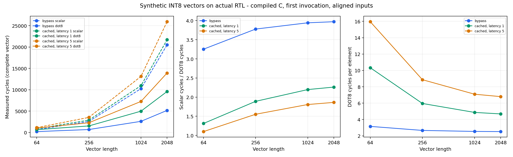
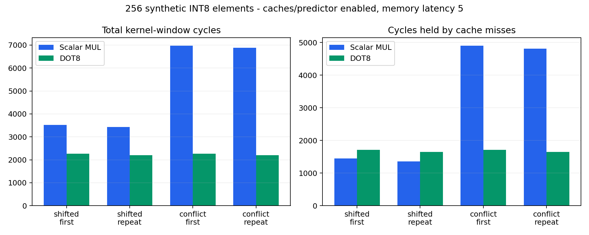

# Measured compiled-C DOT8 results

These are integer kernel measurements on the existing RTL, not end-to-end LLM speedups.
Both scalar and DOT8 use the existing hardware low-word MUL for scalar elements.
Code size is 640 bytes. Data memory is 8 KiB; instruction memory, caches, and pipeline timing are unchanged.

## Executed validation

81 vector cases: 25 synthetic and 56 captured real-data cases. Each full simulator run verifies 1,320 complete-vector kernel invocations across variants, layouts, alignment cases, cache configurations and repetitions.
The existing 42 RTL regression configurations, eight memory-capacity configurations (1/8 KiB), and the bare-metal C smoke test also passed. Capacity tests cover upper-address initialization, non-aliasing, masked writes and reset preservation. Wrong-result rejection was verified in both simulators.

## First invocation, aligned shifted layout

| Source / length | Mode | Scalar cycles | DOT8 cycles | Speedup | Scalar EX instructions | DOT8 EX instructions |
|---|---|---:|---:|---:|---:|---:|
| synthetic / 64 | bypass | 657 | 202 | 3.252x | 460 | 145 |
| synthetic / 64 | cached L5 | 1123 | 1021 | 1.100x | 460 | 145 |
| synthetic / 256 | bypass | 2577 | 682 | 3.779x | 1804 | 481 |
| synthetic / 256 | cached L5 | 3523 | 2269 | 1.553x | 1804 | 481 |
| synthetic / 1024 | bypass | 10257 | 2602 | 3.942x | 7180 | 1825 |
| synthetic / 1024 | cached L5 | 13123 | 7261 | 1.807x | 7180 | 1825 |
| synthetic / 2048 | bypass | 20497 | 5162 | 3.971x | 14348 | 3617 |
| synthetic / 2048 | cached L5 | 25923 | 13917 | 1.863x | 14348 | 3617 |
| real query / 288 | bypass | 2897 | 762 | 3.802x | 2028 | 537 |
| real query / 288 | cached L5 | 3923 | 2477 | 1.584x | 2028 | 537 |
| real FFN / 768 | bypass | 7697 | 1962 | 3.923x | 5388 | 1377 |
| real FFN / 768 | cached L5 | 9923 | 5597 | 1.773x | 5388 | 1377 |

## Scope and interpretation

- Every vector, including the real 768-element FFN row and synthetic 2048-element vectors, executes in one uninterrupted kernel invocation. There is no host chunk accumulation. Host image loading is outside the timing window.
- Historical 1 KiB/chunked measurements are preserved under legacy_1k/ and must not be mixed with these 8 KiB complete-vector results.
- First invocation starts after startup; caches are reset before each simulation, but startup has already touched instruction/stack/control lines. Repeat retains the first invocation's cache and predictor state; it does not imply all data is resident.
- EX instruction counts count non-stalled, non-bubble instructions between the markers. They are not a hardware retired-instruction counter.
- Window includes argument setup, dispatch, function call/return, and result store; startup, image loading, and the marker instructions themselves are excluded from instruction counts. Marker-to-marker cycles include elapsed stall/redirect cycles.
- Cached mode enables both caches and prediction. Latency 1 versus 5 isolates backing-memory delay with the same cached configuration; bypass versus cached also changes prediction.
- Group-scaled floating-point outputs remain host-side. Each group of one real 768-element FFN row is independently verified on RTL. Summing the whole row's integer products is not equivalent to applying one common scale.
- No physical clock frequency, synthesis area, or end-to-end RISC-V inference speedup was measured.

## Separate host profiling

Median matmul fraction of timed forward execution: **96.56%** across three single-thread, 128-step runs.
CLOCK_MONOTONIC function timers; includes instrumentation overhead and WSL scheduling noise. See host_profile.json. This fraction cannot establish target CPU end-to-end speedup.
