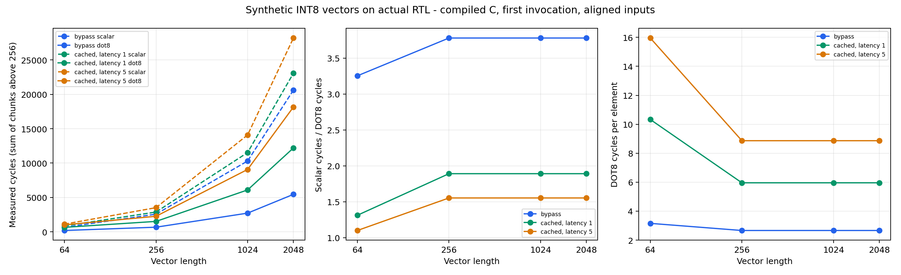
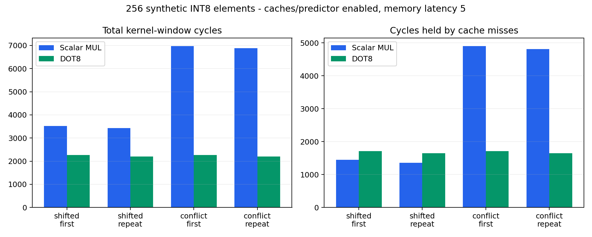

# Measured compiled-C DOT8 results

These are integer kernel measurements on the existing RTL, not end-to-end LLM speedups.
Both scalar and DOT8 use the existing hardware low-word MUL for scalar elements.
Code size is 640 bytes; processor memories and pipeline are unchanged.

## Executed validation

81 vector cases: 25 synthetic and 56 captured real-data cases. Each full simulator run verifies 1,716 kernel invocations across variants, chunks, layouts, alignment cases, cache configurations and repetitions.
The existing 42 RTL regression configurations and the bare-metal C smoke test also passed. Wrong-result rejection was verified in both simulators.

## First invocation, aligned shifted layout

| Source / length | Mode | Scalar cycles | DOT8 cycles | Speedup | Scalar EX instructions | DOT8 EX instructions |
|---|---|---:|---:|---:|---:|---:|
| synthetic / 64 | bypass | 657 | 202 | 3.252x | 460 | 145 |
| synthetic / 64 | cached L5 | 1123 | 1021 | 1.100x | 460 | 145 |
| synthetic / 256 | bypass | 2577 | 682 | 3.779x | 1804 | 481 |
| synthetic / 256 | cached L5 | 3523 | 2269 | 1.553x | 1804 | 481 |
| synthetic / 1024 (4 chunks) | bypass | 10308 | 2728 | 3.779x | 7216 | 1924 |
| synthetic / 1024 (4 chunks) | cached L5 | 14092 | 9076 | 1.553x | 7216 | 1924 |
| real query / 288 (2 chunks) | bypass | 2914 | 804 | 3.624x | 2040 | 570 |
| real query / 288 (2 chunks) | cached L5 | 4246 | 3082 | 1.378x | 2040 | 570 |
| real FFN / 768 (3 chunks) | bypass | 7731 | 2046 | 3.779x | 5412 | 1443 |
| real FFN / 768 (3 chunks) | cached L5 | 10569 | 6807 | 1.553x | 5412 | 1443 |

## Scope and interpretation

- Lengths above 256 sum separate RTL chunk runs. Each chunk restarts the CPU. These totals exclude host loading and cross-chunk accumulation, so they are not a measured streaming implementation.
- First invocation starts after startup; caches are reset before each simulation, but startup has already touched instruction/stack/control lines. Repeat retains the first invocation's cache and predictor state; it does not imply all data is resident.
- EX instruction counts count non-stalled, non-bubble instructions between the markers. They are not a hardware retired-instruction counter.
- Window includes argument setup, dispatch, function call/return, and result store; startup, image loading, and the marker instructions themselves are excluded from instruction counts. Marker-to-marker cycles include elapsed stall/redirect cycles.
- Cached mode enables both caches and prediction. Latency 1 versus 5 isolates backing-memory delay with the same cached configuration; bypass versus cached also changes prediction.
- Group-scaled floating-point outputs remain host-side. Each group of one real 768-element FFN row is independently verified on RTL. Summing the whole row's integer products is not equivalent to applying one common scale.
- No physical clock frequency, synthesis area, or end-to-end RISC-V inference speedup was measured.

## Separate host profiling

Median matmul fraction of timed forward execution: **96.56%** across three single-thread, 128-step runs.
CLOCK_MONOTONIC function timers; includes instrumentation overhead and WSL scheduling noise. See host_profile.json. This fraction cannot establish target CPU end-to-end speedup.
